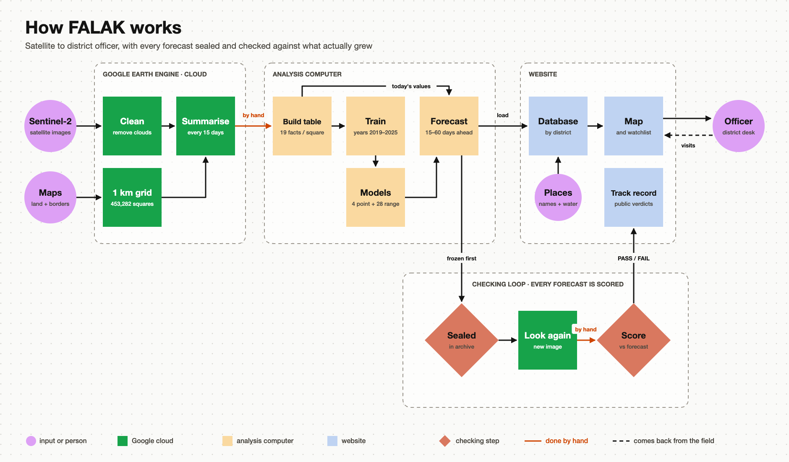
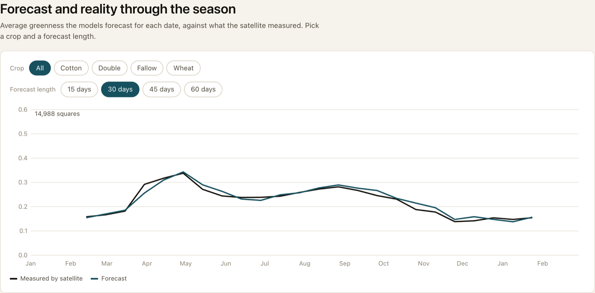
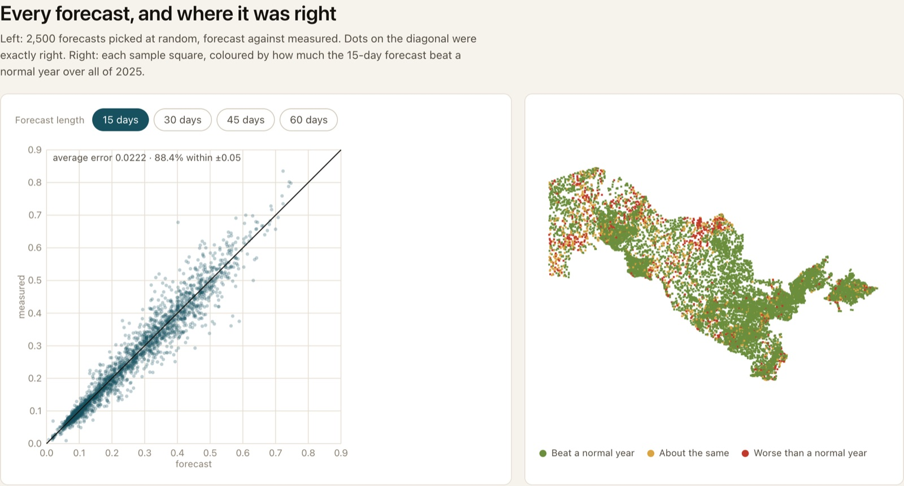
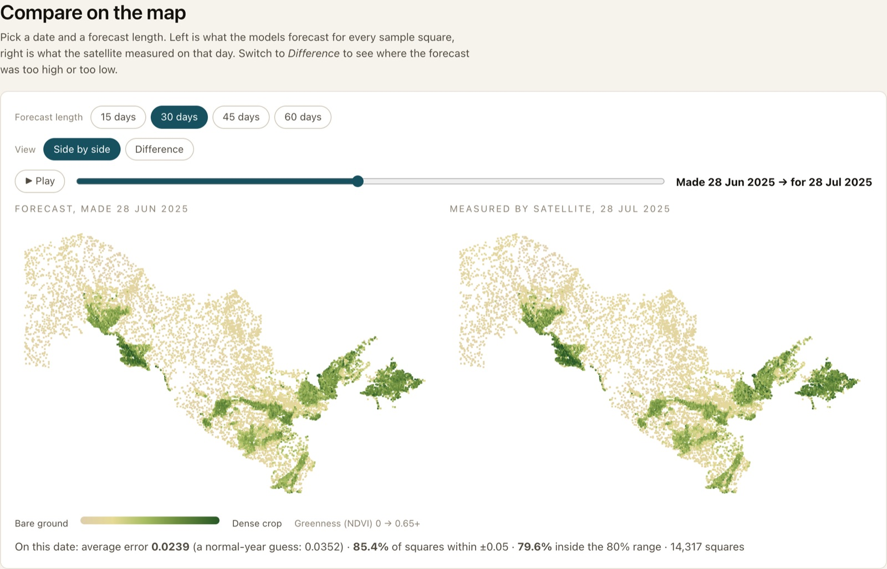
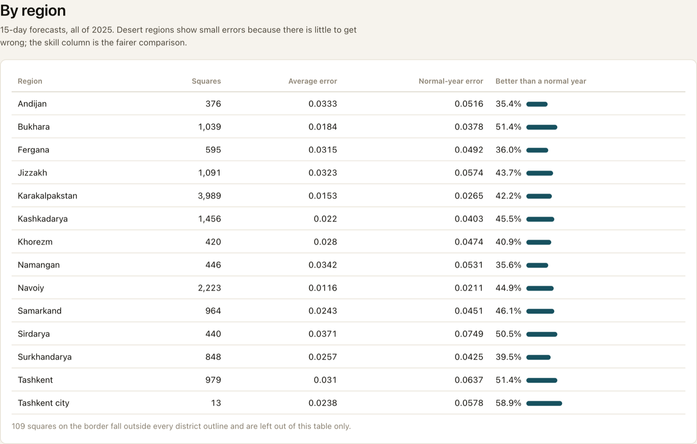

<div align="center">

# FALAK · Earth data and forecasting pipeline

**Crop-condition forecasting for Uzbekistan from Sentinel-2, 15 to 60 days ahead, on a 1 km grid.**

Satellite data gathering, feature engineering, model training, forecast issuing and scoring.

[](https://www.python.org/)
[](https://lightgbm.readthedocs.io/)
[](https://pola.rs/)
[](https://earthengine.google.com/)

**Web platform →** [Zaynobiddin33/falak_v2.0](https://github.com/Zaynobiddin33/falak_v2.0)

</div>

---

FALAK reads Uzbekistan's cropland from orbit every 15 days. It forecasts each 1 km square's greenness (NDVI) 15, 30, 45 and 60 days ahead, with an 80% range around every forecast. Every forecast is **frozen before the outcome exists** and later scored against what the satellite actually measured, pass or fail.

This repository holds everything up to the frozen forecast: the Earth Engine extraction, the training tables, the models and the scoring. The web platform that serves forecasts to district officers lives in **[falak_v2.0](https://github.com/Zaynobiddin33/falak_v2.0)** and reads this repo's `archive/` folder.



## At a glance

| | |
|---|---|
| **Area** | All of Uzbekistan: a 1 km equal-area grid of **453,282** squares, **431,713** with a complete record |
| **Satellite** | Sentinel-2 L2A (`COPERNICUS/S2_SR_HARMONIZED`), 10 m, cloud and snow masked, 15-day composites |
| **Training data** | 2019 – 2025 · 2,428,431 raw composites → **1,421,095** clean rows (58.5% survive) |
| **Models** | LightGBM: **4** point models (one per horizon) + **28** quantile models (q05 – q95) |
| **Inputs** | **19** features per square: recent greenness, trend, seasonal normals, crop type, land cover, harmonic season shape |
| **Horizons** | 15 · 30 · 45 · 60 days |
| **Uncertainty** | 80% range = q10 – q90, widened by a calibrated factor per horizon (×1.40 / 1.50 / 1.70 / 1.68) |
| **Validation** | Trained 2019 – 2023, tuned on 2024, tested on **2025**, a year the models never saw |

## Results: the 2025 test

Every 15-day date in 2025 was treated as an issue date. The shipped models forecast from what was known that day, and each forecast was compared with what Sentinel-2 measured on the day it was for. That is ~206,000 forecasts per horizon on 14,988 sample squares.

| Forecast length | Average error (MAE) | Normal-year guess error | **Better than a normal year** | Within ±0.05 | Inside 80% range* | Anomaly correlation | Bias |
|---|---|---|---|---|---|---|---|
| 15 days | **0.022** | 0.040 | **44.3%** | 88.4% | 81.5% | 0.81 | +0.002 |
| 30 days | **0.028** | 0.039 | **29.5%** | 82.1% | 82.6% | 0.68 | +0.007 |
| 45 days | **0.031** | 0.039 | **18.2%** | 78.0% | 85.4% | 0.55 | +0.009 |
| 60 days | **0.034** | 0.038 | **9.5%** | 75.1% | 85.5% | 0.43 | +0.014 |

NDVI runs from 0 to 1. A *normal-year guess* forecasts each square's own 2019 – 2023 average for that date. *Anomaly correlation* removes the seasonal cycle first, so it measures whether the model caught each square running greener or browner than usual. The model beats both a normal-year guess and "it'll stay as it is today" at every horizon.

\* The range check uses the widening factors tuned on 2024 alone, because the live factors were fitted partly on 2025. The quantile models' early stopping did see 2025, so treat coverage as weaker evidence than the error numbers.

<table>
<tr>
<td width="50%"><br><sub>Average forecast vs measured greenness through 2025, by crop and horizon.</sub></td>
<td width="50%"><br><sub>2,500 random forecasts vs reality, and where the 15-day forecast beat a normal year.</sub></td>
</tr>
<tr>
<td width="50%"><br><sub>Forecast and satellite side by side for any date, or the difference between them.</sub></td>
<td width="50%"><br><sub>15-day skill by region: 35% (Andijan, Namangan) to 51% (Bukhara, Tashkent).</sub></td>
</tr>
</table>

Produced by [`42_backtest_2025.py`](42_backtest_2025.py) and [`43_backtest_maps.py`](43_backtest_maps.py). The numbers are in [`backtest_2025.json`](backtest_2025.json). The interactive version is the `/backtest/2025/` page of the [web platform](https://github.com/Zaynobiddin33/falak_v2.0).

## The frozen record

A forecast is only worth something if it can't be quietly revised. [`34_archive_forecast.py`](34_archive_forecast.py) seals each issue in `archive/<date>/<grid>/`, with the SHA-256 of every model file and the pass rule written in **before** anything is observed. [`35_score_forecast.py`](35_score_forecast.py) later grades it.

**Pass rule:** the 80% range must contain the measured value in at least 75% of squares.

| Issued | Grid | Squares | Result at 15 days | Verdict |
|---|---|---|---|---|
| 13 Jun 2025 | Hindcast (test year, never published) | 12,734 | 87.6% inside, all 4 horizons | ✅ PASS |
| 7 Aug 2026 | National 1 km sample | 14,998 | 74.81% inside · skill +47.8% | ❌ FAIL |
| 7 Aug 2026 | Fergana covering grid | 16,919 | not scored | — |
| 22 Aug 2026 | **Full national grid** | **431,713** | 74.9992% inside · skill +36.0% | ❌ FAIL by 4 squares |

Failures are published at the same size as passes. Both August issues beat a normal-year guess by a wide margin but fell just short of the range target. The widening factors have since been refitted in [`32_quantiles.py`](32_quantiles.py) on two calibration years with a safety margin.

## How the pipeline works

```
Sentinel-2 ──► Earth Engine ──► Google Drive ──► local table ──► models ──► forecast ──► archive ──► platform
                (cloud mask,       (manual          (19 features      (LightGBM)  (point + 80%   (sealed,     (falak_v2.0)
                 15-day composite)   download)        per square)                  range)         SHA-256)
                                                                                      ▲               │
                                                     satellite looks again ──► score ─┴── PASS/FAIL ◄─┘
```

| Stage | Script | What it does |
|---|---|---|
| Grid | `24_build_grid.py` | 1 km equal-area (Lambert azimuthal, centred on Uzbekistan) covering grid, 453,282 squares. Run once. |
| Sample | `sample.py` | Stratified ~15,000-square training sample, oversampling cropland (most of the country is desert). |
| Extract | `16_extract_s2.py` | Sentinel-2 NDVI/EVI for the sample, 15-day medians, cloud/shadow/snow masked via SCL. One CSV per year. |
| Table | `17_build_s2_table.py` | Deduplicates, drops thin composites, builds seasonal normals (2019 – 2023 only), lags, trend and labels. |
| Train | `18_train_s2.py` | One LightGBM model per horizon (L1 loss, 63 leaves), early-stopped on 2024. Saves `models/`. |
| Range | `32_quantiles.py` | 7 quantile models per horizon, then a widening factor `k` so the 80% range really covers ~80%. |
| National grid | `29_extract_grid.py` → `30_build_grid_table.py` | The same 19 features for every square in the country, extracted in 20 longitude chunks. |
| Forecast | `19_predict.py` | Point forecast, 80% range and stress class for every square and horizon. |
| Seal | `34_archive_forecast.py` | Freezes the issue with model fingerprints and its pass rule. |
| Observe | `41_observe_grid.py` | Re-reads the same grid on a valid date, with the same mask. |
| Score | `35_score_forecast.py` | Coverage with a 95% interval, MAE, skill vs normal; flags results within 50 squares of the line. |
| Backtest | `42_backtest_2025.py`, `43_backtest_maps.py` | The 2025 test above, packaged for the web page. |
| Districts | `40_export_districts.py` | FAO GAUL district boundaries for the platform. |

Research and diagnostic scripts are kept too:
- `20`–`23`: report data, harmonics A/B test, model internals.
- `25`–`28`: a 50 m Fergana Valley experiment.
- `31`: validating the grid against the sample.
- `33`, `36`–`39`: honest headline numbers, the hindcast, and the range-calibration investigation.

`modis/` is the retired MODIS-era pipeline. It stays because `17_build_s2_table.py` still reads its land-cover table.

### The 19 features

| Group | Features |
|---|---|
| Recent state | `ndvi`, `ndvi_lag1`, `ndvi_lag2`, `ndvi_lag3`, `ndvi_slope`, `ndvi_accel` |
| What's normal here | `ndvi_normal`, `spring_ndvi_norm`, `summer_ndvi_norm`, `ndvi_anom` |
| What grows here | `crop_type_id`, `landcover` |
| Time of year | `doy`, `month` |
| Season shape | `h_amp1`, `h_amp2`, `h_ratio`, `h_phase1`, `h_phase2` (harmonic fit of each square's yearly curve) |

## Repository layout

```
├── 16_ … 43_*.py        pipeline steps, numbered in the order they were built
├── config.py            Earth Engine project, asset paths, Drive folder, sampling quotas
├── sample.py            the stratified training sample
├── watch_tasks.py       follow Earth Engine export tasks
├── models/              4 point models (LightGBM text format) + manifest.json with test metrics
├── models_q/            28 quantile models
├── quantiles.json       calibrated widening factors per horizon and band
├── archive/             sealed issues: manifest.json (pass rule, model hashes) + scorecard.json
├── backtest_2025.json   the 2025 test results
├── *.json               report outputs (funnel, honest numbers, harmonics, calibration …)
├── modis/               retired MODIS pipeline (still supplies land cover)
└── docs/images/         README figures
```

### Not in this repository

The raw and intermediate data is too large for git, and all of it rebuilds from the scripts:
- **Raw data:** `raw/`, the Earth Engine CSV exports, about 600 MB.
- **Tables:** `parquet/`, the training and grid tables, about 1.6 GB.
- **Forecasts:** the national forecast file, `grid_uz_predictions.json` (210 MB), and the sealed `archive/*/predictions.json` files.

The sealed manifests and scorecards *are* included, so every published verdict can be checked.

## Running it

**Requirements:** Python 3.12 or later, and a Google Earth Engine account linked to a Google Cloud project.

```bash
git clone https://github.com/Zaynobiddin33/Earth-data.git earth && cd earth
python -m venv env && source env/bin/activate
pip install -r requirements.txt
earthengine authenticate
```

Set `PROJECT` in [`config.py`](config.py) to **your own** Earth Engine project ID.

```bash
# 1. data (exports go to Google Drive → download them into raw/)
python 24_build_grid.py                      # once
python 16_extract_s2.py                      # sample, every year since 2019
python 29_extract_grid.py --region uz        # full national grid, 20 chunks

# 2. tables and models
python 17_build_s2_table.py
python 18_train_s2.py
python 32_quantiles.py
python 30_build_grid_table.py --region uz

# 3. issue, seal, score
python 19_predict.py --grid grid_uz
python 34_archive_forecast.py --grid griduz
python 41_observe_grid.py 2026-09-06 --all-chunks        # on the valid date
python 35_score_forecast.py --issued 2026-08-22 --grid griduz

# 4. the 2025 test
python 42_backtest_2025.py && python 43_backtest_maps.py
```

> **One manual step.** Earth Engine can only export to Google Drive, so the CSVs must be downloaded into `raw/` by hand between the extract and table steps. Nothing is scheduled yet.

## Known limitations

- **Winter gaps.** From November to March, cloud and snow hide most squares. Few squares can be scored then, so winter results rest on small samples.
- **Long horizons.** Skill falls from 44% at 15 days to 10% at 60 days. Sudden drops are hard to see coming, and the 60-day forecast leans slightly green (+0.014).
- **"Below normal" isn't always trouble.** An early harvest, a fallow field or a crop change also reads as stress, so field visits matter.
- **Range calibration.** Both August 2026 issues missed the 75% pass rule by small margins. The recalibrated factors are in `quantiles.json` and are being tested on new issues.
- **Legacy input.** Land cover still comes from the MODIS-era table in `modis/`.

## Data sources and credits

- **Sentinel-2 L2A**, Copernicus Programme / ESA. Contains modified Copernicus Sentinel data.
- **ESA WorldCover v200**, land cover for sampling quotas.
- **FAO GAUL 2015**, district boundaries. **USDOS LSIB 2017**, the country outline.
- All accessed through **Google Earth Engine**.

## Related

- **[falak_v2.0](https://github.com/Zaynobiddin33/falak_v2.0)**: the Django web platform. It has the national map, watchlist, district pages, field inspections, the public track record and the interactive 2025 test.
